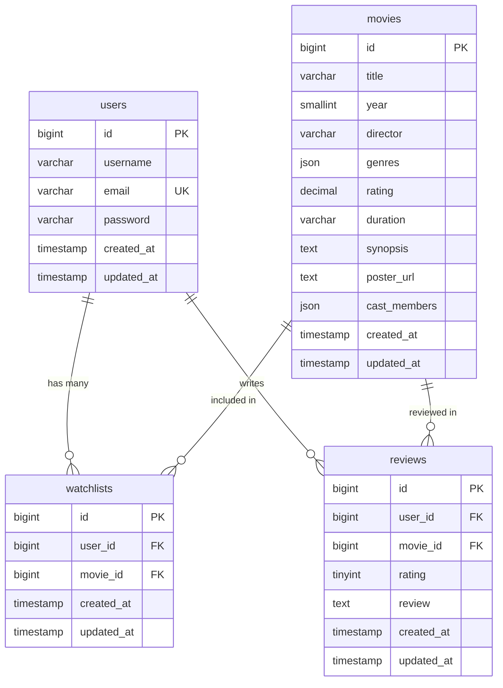

# 🎬 FilmLog — Backend API (Laravel)

Layanan **RESTful API** untuk **FilmLog (Movie Watchlist & Review Platform)** — Tugas Rekrutmen Back-End GDGoC UGM 26/27. Dibangun dengan **Laravel 13 (PHP 8.3+)**, autentikasi stateless **JWT** (`php-open-source-saver/jwt-auth`), database **SQLite / PostgreSQL**, dan integrasi **Google Gemini API** dengan strategi *database grounding* berlapis.

---

## 🔗 Link Penting

| | Tautan |
| :--- | :--- |
| 🌐 **Live Deployment (API)** | <ISI_URL_DEPLOY_VERCEL> |
| 📘 **Dokumentasi API (Postman, online)** | https://documenter.getpostman.com/view/58696710/2sBYHYuJEJ |
| 📦 **File Postman Collection (untuk di-import)** | [`movie-backend/docs/movie-watchlist-api.postman_collection.json`](movie-backend/docs/movie-watchlist-api.postman_collection.json) |
| 🗄️ **ERD (DBML)** | [`movie-backend/docs/erd.dbml`](movie-backend/docs/erd.dbml) (visualisasikan di [dbdiagram.io](https://dbdiagram.io/d)) |

---

## 📖 Tentang Proyek

Repositori ini berasal dari *starter pack* penugasan, yang menyediakan:

1. **Initial Seed Database** (`data/movies.json` dan `data/seed.sql`): 20 film kurasi awal dengan atribut lengkap.
2. **Frontend Companion** (`frontend/`): antarmuka bertema Letterboxd untuk menguji endpoint backend secara visual.

Backend (`movie-backend/`) mengimplementasikan seluruh kontrak API frontend: autentikasi, katalog film, watchlist, riwayat tonton beserta ulasan, dan rekomendasi film berbasis **Google Gemini** yang dibatasi pada 20 film di database.

**Fitur utama**
- Registrasi dan login dengan password ter-hash (bcrypt) serta token JWT.
- Katalog film dengan filter genre, pencarian judul/sutradara, dan urutan acak.
- Watchlist dan riwayat tonton per pengguna (rating 1–5 dan ulasan).
- Rekomendasi AI dengan *database grounding* dan validasi pasca-respons.
- Validasi input, status code HTTP semantik, dan seluruh error berformat JSON.
- Automated feature tests (PHPUnit) dan konfigurasi siap deploy (Vercel / FrankenPHP).

---

## 📁 Struktur Repositori

```text
movie-watchlist-starter/
├── data/
│   ├── movies.json          # Data 20 film awal (format JSON)
│   └── seed.sql             # Skrip SQL INSERT (PostgreSQL & MySQL)
├── frontend/
│   ├── index.html           # Frontend Letterboxd-style SPA (zero-build Tailwind)
│   ├── app.js               # Client logic & API caller
│   └── README.md            # Panduan menjalankan frontend
├── movie-backend/           # Backend REST API (Laravel + JWT + Gemini)
│   ├── app/                 # Controllers, Form Requests, API Resources, Models, Services
│   │   └── Services/GeminiRecommender.php
│   ├── database/            # Migrations & seeders
│   ├── routes/api.php       # Definisi rute API
│   ├── tests/Feature/       # Automated tests (WatchlistApiTest.php)
│   ├── docs/                # erd.dbml & Postman collection
│   └── vercel.json, api/index.php, Dockerfile, Caddyfile   # Konfigurasi deployment
└── README.md                # Dokumen ini
```

---

## 📋 Prasyarat

Pastikan perangkat Anda telah terinstal:
- **PHP** >= 8.3 (direkomendasikan PHP 8.3 / 8.4 / 8.5 dengan ekstensi `pdo_sqlite`, `mbstring`, `openssl`, `curl`)
- **Composer** >= 2.x
- **Python 3** (opsional, untuk menjalankan static server `frontend/`)
- **Google Gemini API Key** (gratis melalui [Google AI Studio](https://aistudio.google.com/app/apikey))

---

## 🚀 Panduan Instalasi & Setup

1. **Clone repositori dan masuk ke direktori backend:**
   ```bash
   git clone https://github.com/ITermss/movie-watchlist-starter.git
   cd movie-watchlist-starter/movie-backend
   ```

2. **Instal dependensi PHP melalui Composer:**
   ```bash
   composer install
   ```

3. **Salin file environment `.env.example` menjadi `.env`:**
   ```bash
   cp .env.example .env
   ```
   *(Di Windows PowerShell: `Copy-Item .env.example .env`)*

4. **Generate Application Key dan JWT Secret:**
   ```bash
   php artisan key:generate
   php artisan jwt:secret
   ```

5. **Atur konfigurasi di dalam file `.env`:**
   Pastikan variabel berikut terisi:
   ```env
   DB_CONNECTION=sqlite

   AUTH_GUARD=api
   JWT_TTL=1440

   GEMINI_API_KEY=isi_api_key_anda_di_sini
   GEMINI_MODEL=gemini-3.5-flash
   ```

6. **Siapkan file database SQLite, lalu jalankan migrasi beserta seeder (20 film awal):**
   ```bash
   touch database/database.sqlite
   php artisan migrate:fresh --seed
   ```
   *(Di Windows PowerShell jika file belum ada: `New-Item -ItemType File -Force database/database.sqlite`)*

---

## ▶️ Cara Menjalankan Aplikasi

1. **Jalankan server backend Laravel (port 8000)** dari folder `movie-backend`:
   ```bash
   php artisan serve --port=8000
   ```
   API aktif di `http://localhost:8000/api`.

2. **Jalankan Frontend Companion (port 3000)** di terminal terpisah:
   ```bash
   cd ../frontend
   python -m http.server 3000 --bind 127.0.0.1
   ```
   Buka `http://localhost:3000` di browser untuk menguji seluruh fitur secara visual dan memantau request melalui **API Network Inspector**.

---

## 📘 Dokumentasi API

- **Online (Postman):** https://documenter.getpostman.com/view/58696710/2sBYHYuJEJ
- **File collection:** [`movie-backend/docs/movie-watchlist-api.postman_collection.json`](movie-backend/docs/movie-watchlist-api.postman_collection.json)

Cara memakai file collection:
1. Postman → **Import** → pilih file tersebut.
2. Pastikan variabel `base_url` mengarah ke server (default `http://localhost:8000/api`).
3. Jalankan **Daftar Akun Baru**, lalu **Masuk dan Dapatkan Token**. Token tersimpan otomatis.
4. Jalankan request lainnya. Tiap request punya deskripsi dan contoh respons sukses maupun error.

### Daftar Endpoint & Kontrak API

Semua endpoint memakai prefix `/api`. Seluruh respons error selalu berbentuk JSON dengan properti `{"message": "..."}`.

#### 1. Autentikasi (`Public`)
| Method | Endpoint | Body Request | Status Code | Deskripsi |
| :--- | :--- | :--- | :--- | :--- |
| `POST` | `/api/auth/register` | `{ "username", "email", "password" }` | `201`, `422` | Registrasi akun baru (`username` maks 50 karakter, `email` unik, `password` min 8 karakter di-hash dengan bcrypt). Mengembalikan `{ message, user }`. |
| `POST` | `/api/auth/login` | `{ "email", "password" }` | `200`, `401`, `422` | Login pengguna dan mengembalikan `{ token, user: { id, username, email } }`. |

#### 2. Katalog Film & Rekomendasi AI (`Public`)
| Method | Endpoint | Query / Body | Status Code | Deskripsi |
| :--- | :--- | :--- | :--- | :--- |
| `GET` | `/api/movies` | `?genre=`, `?search=`, `?random=true` | `200` | Mengembalikan array daftar film dengan filter opsional berdasarkan genre, judul/sutradara, atau urutan acak. |
| `GET` | `/api/movies/{id}` | - | `200`, `404` | Mengembalikan detail satu film berdasarkan ID. |
| `POST` | `/api/movies/recommend` | `{ "prompt": "..." }` | `200`, `422`, `429`, `502`, `503`, `504` | Rekomendasi 1 film dari katalog database menggunakan Google Gemini (`{ movie_id, reasoning }`). Dilindungi *rate limiter* `throttle:10,1` (10 req/menit). |

Contoh respons rekomendasi:
```json
{
  "movie_id": 14,
  "reasoning": "Memento sangat cocok dengan preferensi misteri Anda karena..."
}
```

#### 3. Watchlist (`Protected`, header `Authorization: Bearer <token>`)
| Method | Endpoint | Body Request | Status Code | Deskripsi |
| :--- | :--- | :--- | :--- | :--- |
| `GET` | `/api/watchlist` | - | `200`, `401` | Daftar film di watchlist milik user yang sedang login (`[{ movie_id, movie, created_at }]`). |
| `POST` | `/api/watchlist` | `{ "movieId": 1 }` | `201`, `401`, `404`, `409`, `422` | Menambahkan film ke watchlist. Mengembalikan `409 Conflict` jika film sudah ada di watchlist user. |
| `DELETE` | `/api/watchlist/{movieId}` | - | `200`, `401`, `404` | Menghapus film dari watchlist user yang sedang login. |

#### 4. Watched & Reviews (`Protected`, header `Authorization: Bearer <token>`)
| Method | Endpoint | Body Request | Status Code | Deskripsi |
| :--- | :--- | :--- | :--- | :--- |
| `GET` | `/api/watched` | - | `200`, `401` | Riwayat film yang sudah ditonton beserta rating dan ulasan milik user (`[{ id, movie_id, rating, review, created_at, movie }]`). |
| `POST` | `/api/watched` | `{ "movieId": 1, "rating": 5, "review": "..." }` | `201`, `200`, `401`, `404`, `422` | Mencatat atau memperbarui rating (`1-5`) dan ulasan film (maks 2000 karakter). Mengembalikan `201 Created` untuk ulasan baru atau `200 OK` jika memperbarui ulasan yang sudah ada. |

---

## 🗄️ Skema Database & ERD

Definisi Entity-Relationship Diagram (DBML) ada di [`movie-backend/docs/erd.dbml`](movie-backend/docs/erd.dbml) dan dapat divisualisasikan di [dbdiagram.io](https://dbdiagram.io/d).



### Keputusan Desain Utama
1. **Integritas Relasional & Anti-Duplikasi**: Tabel `watchlists` dan `reviews` menggunakan *foreign key* dengan `ON DELETE CASCADE` serta *composite unique constraint* `UNIQUE(user_id, movie_id)` di level database untuk mencegah duplikasi data sekalipun terjadi *race condition*.
2. **Keamanan & Isolasi Data (*Data Scoping*)**: Seluruh operasi baca/tulis pada `watchlists` dan `reviews` selalu di-*scope* ke `$request->user()->id` dari payload JWT yang terverifikasi. ID pengguna tidak pernah diterima dari body/query request (mencegah celah IDOR).
3. **Strategi *Database Grounding* Gemini**:
   - Menyuntikkan katalog film dari database lokal ke dalam `<movie_catalog>` di `systemInstruction`.
   - Mengisolasi input pengguna di dalam tag `<user_preferences>` sebagai data untuk memitigasi *prompt injection*.
   - Memaksa output JSON terstruktur melalui `responseMimeType: application/json` dan `responseJsonSchema` (`movie_id` integer & `reasoning` string).
   - Melakukan validasi pasca-respons (`in_array($movieId, $validIds, true)`) di kode PHP dengan *auto-retry* 1 kali apabila LLM mengembalikan ID di luar katalog.

---

## 🧪 Pengujian Otomatis (Automated Tests)

Jalankan *feature test* PHPUnit dari folder `movie-backend` (memakai SQLite `:memory:` sehingga aman bagi data lokal Anda):

```bash
php artisan test
```

Skenario yang diuji di `tests/Feature/WatchlistApiTest.php`:
- Akses rute terproteksi (`/api/watchlist` & `/api/watched`) tanpa token menghasilkan `401 Unauthorized` JSON meskipun tanpa header `Accept: application/json`.
- Menambahkan film duplikat ke watchlist menghasilkan `409 Conflict`.
- Rating review di luar rentang 1–5 (mis. `9` atau `0`) menghasilkan `422 Unprocessable Content`.
- Isolasi data antar pengguna (User B tidak dapat melihat atau menghapus watchlist User A).
- Validasi pasca-respons dan mekanisme *retry* pada `GeminiRecommender` ketika respons pertama mengembalikan `movie_id` di luar katalog database.

---

## ☁️ Deployment ke Vercel / Cloud 

Proyek ini dilengkapi konfigurasi untuk *serverless deployment* di **Vercel** (`vercel.json`, `api/index.php`, `.vercelignore`) maupun *container deployment* berbasis **FrankenPHP** (`Dockerfile` & `Caddyfile`).

### Langkah Deploy ke Vercel
1. Buat database PostgreSQL/MySQL online gratis (misalnya di **Neon.tech**, **Supabase**, atau **Aiven**).
2. Import repositori GitHub Anda ke dashboard [Vercel](https://vercel.com/new) dan atur **Root Directory** ke `movie-backend`.
3. Tambahkan **Environment Variables** berikut di dashboard Vercel:
   ```env
   APP_KEY=base64:...               # Salin dari .env lokal Anda
   JWT_SECRET=...                   # Salin dari .env lokal Anda
   GEMINI_API_KEY=...               # API key Google Gemini Anda
   GEMINI_MODEL=gemini-3.5-flash

   DB_CONNECTION=pgsql              # Atau mysql
   DB_HOST=...
   DB_PORT=5432
   DB_DATABASE=...
   DB_USERNAME=...
   DB_PASSWORD=...
   ```
4. Jalankan migrasi dan seeder dari komputer lokal Anda dengan mengarahkan koneksi ke database online tersebut satu kali:
   ```bash
   php artisan migrate:fresh --seed --force
   ```
5. Klik **Deploy** di Vercel. Setelah selesai, masukkan URL Vercel Anda (`https://nama-app.vercel.app/api`) pada tombol pengaturan API di pojok kanan atas Frontend Companion.